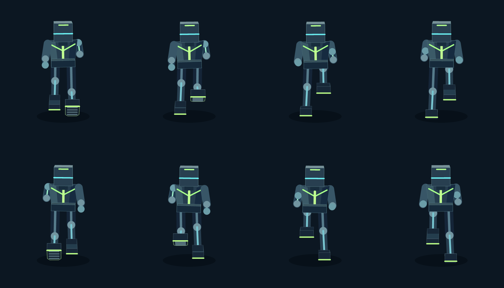
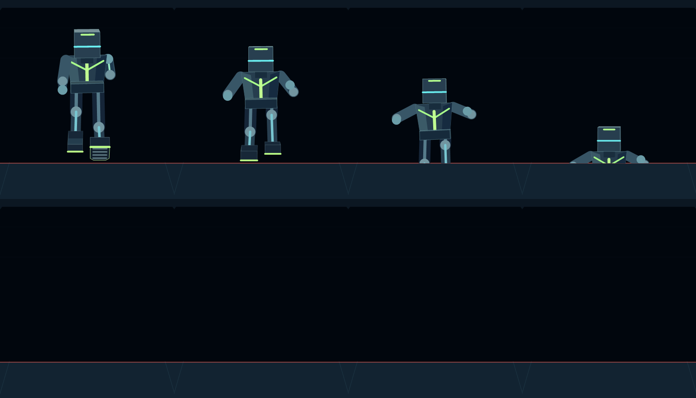

# NEON STRIDE

> **끝없이 달려라. 한계를 넘어라.** — _Run beyond limits._

2186년, 네온으로 빛나는 **NEW SEOUL**의 공중 도로를 달리는 SF 무한 러너 게임입니다. 점프·2단 점프·슬라이딩·좌우 이동으로 장애물을 피하고, 무작위로 나타나는 90° 코너를 돌며 최고 기록에 도전하세요.

**Canvas 2D · 4개 난이도 · 13종 장애물·구역 · 랜덤 90° 코너 · 키보드·터치 조작 · 단일 HTML 배포**

## 온라인에서 플레이

**[NEON STRIDE 게임 실행](https://neon-stride-run-kr.famousessay4.chatgpt.site/)**

설치나 로그인 없이 브라우저에서 플레이할 수 있습니다. 공개 호스팅에서 제공되므로 개발 PC가 꺼져 있어도 접속할 수 있습니다. 검색엔진 소유확인과 사이트맵 제출 절차는 [배포 안내](neon-stride/docs/DEPLOYMENT.md)에 정리되어 있습니다.

## 최근 반영 사항

- **랜덤 코너와 좌우 이동:** 도로가 좌우로 90° 꺾입니다. `←/→`는 좌우 이동, `Shift + ←/→`는 안내 방향 코너링입니다.
- **보안 장애물 5종:** 에너지 파괴광선, EMP 간섭 구역, 왕복 순찰 드론·호버 봇, 시간차 셔터, 공중 드론 3대의 조준 레이저를 추가했습니다.
- **난이도 색상:** 쉬움 초록, 보통 노랑, 어려움 빨강, 매우 어려움 보라로 구분합니다.
- **괴물 방망이 회피:** 슬라이딩과 2단 점프 모두 가능하도록 충돌 판정을 조정했습니다. 일반 점프만으로는 넘을 수 없습니다.
- **괴물 공격 동작:** 양손으로 방망이를 뒤로 당긴 뒤 몸통을 틀며 빠르게 휘두릅니다. 후속 스윙과 궤적 잔상도 추가했습니다.
- **러너 달리기 동작:** 양팔의 앞뒤 스윙 폭을 확대하고, 관절 길이와 점프 중 팔 자세는 유지했습니다.
- **공개 배포·검색 설정:** 공개 플레이 주소, 한글·영문 제목과 설명, 대표 URL, 사이트맵, 검색 수집 설정을 반영했습니다.

## 빠르게 시작하기

### 파일을 바로 열어 플레이

[`neon-stride/NEON-STRIDE.html`](neon-stride/NEON-STRIDE.html)을 다운로드한 뒤 브라우저로 열면 별도의 서버 없이 플레이할 수 있습니다.

### 로컬 서버로 실행

Node.js와 npm이 설치된 환경에서 저장소 루트를 기준으로 실행합니다. 처음에는 `npm ci`로 빌드·포맷팅용 개발 도구를 설치합니다. 게임의 브라우저 실행에는 외부 JavaScript 라이브러리를 사용하지 않습니다.

```bash
cd neon-stride
npm ci
npm start
```

## 조작 방법

### 키보드

| 동작           | 키                        | 설명                                         |
| -------------- | ------------------------- | -------------------------------------------- |
| 시작·재시작    | `Space` / `↑` / `W`       | 준비 화면이나 게임 오버 화면에서 달리기 시작 |
| 점프           | `Space` / `↑` / `W`       | 공중에서 한 번 더 누르면 2단 점프            |
| 슬라이딩       | `↓` / `S`                 | 누르고 있는 동안 낮은 자세 유지              |
| 일시 정지·계속 | `P` / `Esc`               | 달리기를 멈추거나 재개                       |
| 좌우 이동      | `←` / `→`                 | 누르는 동안 도로 폭 안에서 좌우 이동         |
| 90° 코너링     | `Shift + ←` / `Shift + →` | 코너 앞 안내 방향으로 회전                   |

**공중에서도 슬라이딩으로 즉시 전환할 수 있습니다.** 점프를 취소하고 지면으로 내려오므로, 도로가 끊긴 구간에서는 착지 위치에 주의하세요.

코너는 위치와 방향이 무작위로 생성됩니다. 약 3초 전부터 안내가 나오며, 코너 도착 **0.6초 전부터 0.16초 후까지** 올바른 방향을 입력하면 회전합니다. 미리 입력한 회전은 교차로에서 실행됩니다. 너무 일찍 누른 입력은 예약되지 않으며, 방향을 틀리거나 코너를 놓치면 게임이 종료됩니다. 코너 주변에는 다른 장애물이 겹치지 않도록 여유 구간을 둡니다.

### 터치

| 동작          | 입력                                            |
| ------------- | ----------------------------------------------- |
| 점프·2단 점프 | 게임 화면 탭 또는 위로 스와이프                 |
| 슬라이딩      | 게임 화면을 아래로 스와이프                     |
| 화면 버튼     | `JUMP ×2` / `SLIDE` 버튼 사용                   |
| 좌우 이동     | `←/→` 버튼을 누르거나 좌우 스와이프             |
| 코너링        | 코너 입력 구간에서 좌우 버튼 또는 좌우 스와이프 |

터치 버튼은 터치 포인터 환경 또는 화면 너비 600px 이하에서 플레이 중 표시됩니다. 터치 슬라이딩은 한 번 입력할 때 약 **0.9초** 동안 유지됩니다.

상단의 **효과음 버튼**으로 소리를 켜고 끌 수 있으며, **`?` 버튼**에서 조작 안내를 확인할 수 있습니다. 다른 창으로 이동하거나 탭이 숨겨지면 달리기가 자동으로 일시 정지됩니다.

## 게임 규칙과 기록

- **생존 시간 1초당 10점**을 얻습니다. 일시 정지 중에는 점수가 쌓이지 않습니다.
- 시간이 지날수록 속도가 증가하며, 난이도별 최고 속도에 도달하면 유지됩니다.
- 장애물 순서와 간격은 무작위로 생성됩니다. 재시작할 때마다 새로운 코스가 펼쳐집니다.
- 장애물에 부딪히거나 도로 아래로 떨어지면 게임이 종료됩니다.
- 결과 화면에서 **점수·달린 시간·이동 거리·통과한 장애물 수**를 확인할 수 있습니다.
- 최고 기록은 **난이도별로 현재 브라우저에 저장**됩니다. 브라우저 데이터를 지우면 기록도 사라지며, 기기 간 동기화는 제공하지 않습니다.

## 난이도

게임 시작 전이나 게임 오버 후에 선택할 수 있습니다. 플레이·일시 정지·낙하 중에는 변경할 수 없습니다.

| 난이도          | 시작 → 최고 속도 | 플레이 특징                                            |
| --------------- | ---------------- | ------------------------------------------------------ |
| **쉬움**        | 14 → 30          | 여유 있는 간격으로 조작과 장애물을 익히는 질주         |
| **보통**        | 19 → 38          | 더 빠른 속도에서 리듬을 유지하는 질주                  |
| **어려움**      | 31 → 53          | 짧아진 대응 시간과 간격 속에서 빠른 판단이 필요한 질주 |
| **매우 어려움** | 48 → 76          | 높은 속도와 짧은 예고로 순발력의 한계를 시험하는 질주  |

속도는 게임 내부 수치입니다. HUD의 배속은 쉬움의 시작 속도인 14를 기준으로 표시됩니다.

## 장애물 공략

| 장애물            | 특징                                                       | 권장 대응                                      |
| ----------------- | ---------------------------------------------------------- | ---------------------------------------------- |
| 낮은 방벽         | 청록색의 낮은 장벽                                         | **점프**                                       |
| 높은 방벽         | 주황색의 높은 장벽                                         | **2단 점프**                                   |
| 게이트            | 몸 위쪽을 막는 보라색 통로                                 | **슬라이딩**                                   |
| 낭떠러지          | 도로가 끊긴 구간                                           | **2단 점프**로 건너편까지 이동                 |
| 괴물              | 양손으로 방망이를 당긴 뒤 강하게 휘두르는 괴물             | **슬라이딩 또는 2단 점프**                     |
| 쓰러진 나무       | 한 그루 또는 두 그루가 겹친 나무                           | 한 그루는 **점프**, 두 그루는 **2단 점프**     |
| 도로 붕괴         | 철골 낙하로 사라지는 도로                                  | **2단 점프**로 전체 구간 통과                  |
| 가로 불기둥       | 얼굴 높이로 가로지르는 화염                                | **슬라이딩**                                   |
| 에너지 파괴광선   | 도로 전체를 가로막는 고출력 광선                           | **2단 점프**                                   |
| EMP 방해 구역     | 잠시 약한 노이즈와 글리치가 생기는 구역, 직접 충돌 없음    | 조작 유지·전방 주시                            |
| 순찰 드론·호버 봇 | 도로 좌우를 일정 속도로 왕복하는 보안 장치                 | **좌우 이동**으로 빈 공간 통과                 |
| 시간차 셔터       | 상하 금속 문이 열리거나 닫히는 통로                        | 닫히는 문은 **슬라이드**, 열리는 문은 **점프** |
| 공중 드론 편대    | 3대가 바닥 위치를 먼저 고정 조준한 뒤 순서대로 레이저 발사 | 붉은 표식 밖으로 **좌우 이동**                 |

## 기술과 프로젝트 구조

게임은 **JavaScript ES Modules, Canvas 2D, CSS, Web Audio API, localStorage**로 구현되어 있습니다. 외부 JavaScript 라이브러리 없이 원근 투영으로 도시를 그리고, 관절 계산과 포즈 보간으로 러너를 움직입니다.

```text
NeonStride/
├── README.md
└── neon-stride/
    ├── src/                    # 직접 편집하는 원본
    │   ├── application/        # 앱 조립·프레임 루프
    │   ├── config/             # 규칙·난이도·조작키·문구·효과음 설정
    │   ├── game/               # 러너·물리·장애물 생성·충돌
    │   ├── animation/          # 보행·관절 계산·점프·낙하 포즈
    │   ├── rendering/          # 도시·도로·장애물·캐릭터 부위별 렌더러
    │   ├── input/              # 키보드·터치·창 전환 처리
    │   ├── services/           # 기록 저장·효과음
    │   ├── ui/                 # 화면별 HTML 조각과 UI 컨트롤러
    │   ├── styles/             # 구성 요소별 스타일과 반응형 규칙
    │   ├── shared/             # 이벤트 정리·표시 형식
    │   └── app.js              # 브라우저 진입점
    ├── dist/                   # src에서 생성한 정적 배포 결과
    ├── scripts/                # HTML 조립·자산 복사·단일 파일 번들링
    ├── tests/                  # 기능별 테스트와 독립 실행용 fixture
    ├── docs/                   # 구조와 개발 방법
    ├── previews/               # 러너 포즈 데이터·이미지·생성 도구
    ├── .openai/hosting.json     # 정적 호스팅 설정
    ├── server.mjs              # 로컬 개발 서버
    ├── build-standalone.mjs    # 단일 HTML 생성 도구
    ├── NEON-STRIDE.html        # 서버 없이 여는 배포 파일
    └── package.json
```

**게임을 수정할 때는 `src/`를 편집합니다.** `dist/`와 `NEON-STRIDE.html`은 빌드로 생성되므로 직접 수정하지 않습니다. `npm start`와 `npm test`는 먼저 `src/`를 빌드합니다. 서버를 켠 채 원본을 수정했다면 별도 터미널에서 `npm run build`를 실행하고 브라우저를 새로고침하세요.

규칙·난이도는 `config/`, UI는 `ui/`, 그림은 `rendering/`, 스타일은 `styles/`에서 찾을 수 있습니다. 자세한 의존 관계와 수정 지점은 [구조 안내](neon-stride/docs/ARCHITECTURE.md)에 정리되어 있습니다.

<details>
<summary>러너 애니메이션 미리보기</summary>

달리기 포즈와 낙하 연출을 프레임별로 확인할 수 있습니다.





</details>

## 테스트와 배포

아래 명령은 모두 **`neon-stride/` 폴더에서** 실행합니다.

### 테스트 실행

```bash
npm test
```

또는 `node --test`로 직접 실행할 수 있습니다. Node.js 내장 테스트 러너로 점프·슬라이드·충돌·난이도·점수·재시작·낙하 처리, 캐릭터 관절과 보행, UI 연결을 검증합니다. 괴물 방망이의 슬라이딩·2단 점프 회피, 양손 그립과 스윙 단계, 확대된 러너 팔 스윙 범위도 테스트합니다. UI 연결 테스트는 최소 DOM·Canvas 모형을 사용하므로 실제 브라우저의 레이아웃·터치 확인도 함께 진행해야 합니다.

좌우 이동 범위·키 해제, 양방향 90° 코너의 성공·실패·재시작, 새 장애물의 회피 조건과 조준 위치 고정도 검사합니다. 네 난이도에서 각각 10분 동안 13종 장애물과 랜덤 코너를 통과하는 자동 주행 검증을 포함합니다. 기능별 테스트로 옮겨진 레거시 중복 파일은 정리했습니다.

### 코드 포맷팅

```bash
npm run format
npm run format:check
```

첫 명령은 저장소의 JavaScript·HTML·CSS·JSON·SVG·문서를 포맷팅하고, 두 번째 명령은 형식만 검사합니다. `dist/`와 단일 HTML도 검사 대상이며, 빌드로 조립되는 HTML은 출력 단계에서 자동 포맷팅합니다. 공통 기준은 저장소 루트의 `.prettierrc.json`에 있습니다. PowerShell 미리보기 스크립트는 별도로 정리되어 있습니다.

### 단일 HTML 다시 생성

```bash
node build-standalone.mjs
```

`src/`에서 `dist/`를 새로 생성한 뒤 HTML·CSS·JavaScript·아이콘을 합쳐 **`NEON-STRIDE.html`을 덮어씁니다.** `npm run build:standalone`으로도 같은 작업을 실행할 수 있습니다. 게임 코드를 수정한 뒤 다시 생성하면 단일 파일 배포판에도 변경 사항이 반영됩니다.

생성된 파일은 브라우저로 직접 열어 사용할 수 있습니다. Google Fonts는 외부에서 불러오므로 네트워크가 없는 환경에서는 대체 글꼴로 표시됩니다.

### 정적 웹 호스팅

`npm run build`를 실행한 뒤 `dist/` 폴더의 파일을 디렉터리 구조 그대로 정적 웹 서버에 올리면 됩니다. 포함된 `.openai/hosting.json`도 정적 배포 대상으로 `dist`를 지정합니다. 게임 진행과 기록 저장에 별도의 백엔드나 데이터베이스는 사용하지 않습니다.
