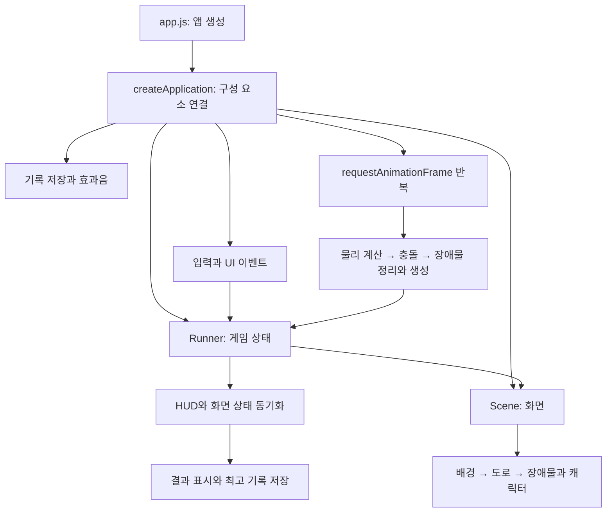
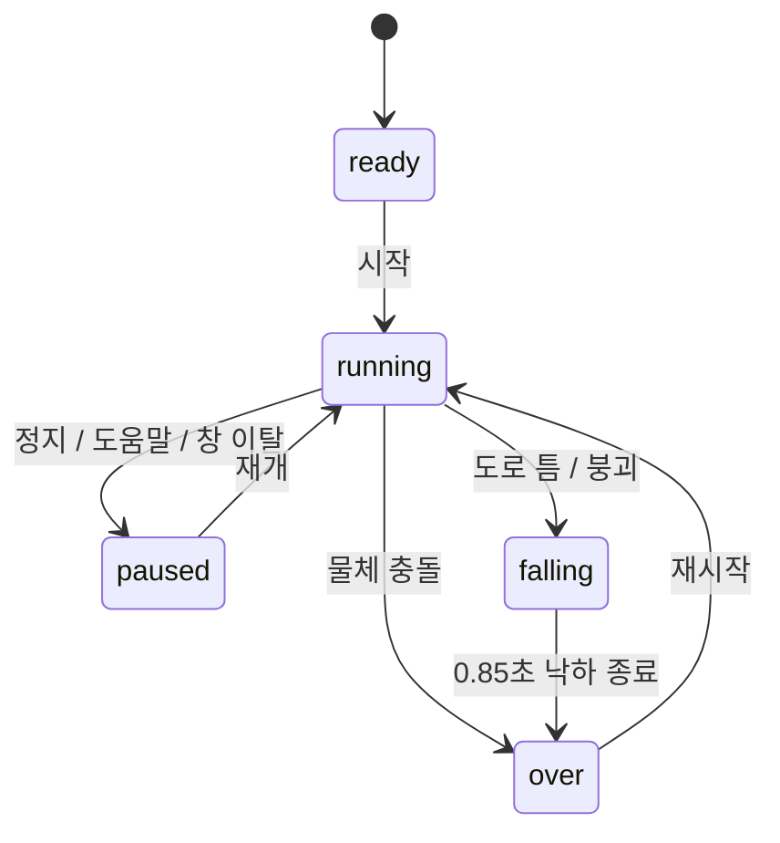

# NEON STRIDE 전체 코드 리뷰

검토일: 2026-11-17. 기준 커밋: `fa9c940`. 검토 대상은 현재 저장소의 원본, 생성물, 테스트, 빌드 도구와 문서입니다. 게임 소스 수정·커밋·배포는 수행하지 않았습니다.

## 1. 우선 확인할 문제

P1은 플레이를 중단시키는 문제로 우선 수정할 항목, P2는 특정 환경의 기능 오류, P3는 표시·접근성·유지보수 보완 항목입니다. 아래의 재현 결과는 현재 코드에서 확인했습니다.

### 1) P1 — 긴 프레임 공백 직후 재개하면 조작 없이 충돌한다

위치: [loop.js](../../neon-stride/src/application/loop.js#L17), [재개 처리](../../neon-stride/src/application/create-app.js#L63).

프레임 사이의 실제 시간 차이를 그대로 `game.update(dt)`에 넘깁니다. `reset()`도 애니메이션 시간만 초기화하며 이전 프레임 시각은 지우지 않습니다. 탭이 숨겨져 프레임이 중단된 후, 복귀한 첫 프레임보다 먼저 재개 입력이 처리되면 숨겨져 있던 시간까지 플레이 시간으로 소비합니다. 실행 중 긴 메인 스레드 정지가 발생해도 같은 방식으로 따라잡습니다.

테스트 호스트로 `1000ms → 1100ms → blur로 정지 → 30초 프레임 공백 → 재개 → 31100ms` 순서를 주었습니다. 정지 직전 1점이던 게임이 다음 프레임 한 번에 33점·`over`·`low` 충돌로 바뀌었습니다. 모든 탭 복귀에서 발생한다는 뜻은 아니며, 첫 복귀 프레임과 재개 이벤트의 순서에 따라 발생합니다.

권장: 시작·재개·가시성 전환에서 루프 시계를 다시 맞추고, 비정상적으로 큰 화면 프레임 간격의 처리 정책을 정합니다. 엔진의 세부 시간 분할은 충돌 누락을 막는 장치이므로 유지해야 합니다. 엔진이 긴 시간을 정확히 계산하는 것과 사용자에게 조작 기회를 주는 것은 별개의 문제입니다.

### 2) P2 — 없는 파일 한 번의 요청으로 로컬 개발 서버가 종료된다

위치: [server.mjs](../../neon-stride/server.mjs#L23).

파일을 읽기 전에 200 응답 헤더를 설정합니다. `readFile()`이 실패하면 `catch`에서 다시 404 헤더를 설정하다가 `ERR_HTTP_HEADERS_SENT`가 발생합니다. 비동기 요청 핸들러의 거절이 처리되지 않아 Node 프로세스가 종료됩니다.

현재 `server.mjs`를 별도 프로세스로 실행해 `/`의 200 응답을 확인한 다음 `/__review_missing__.js`를 요청했습니다. 요청이 실패하고 프로세스는 종료 코드 1로 끝났습니다. 오류 위치는 29행이었습니다.

권장: 파일을 성공적으로 읽은 뒤 200 헤더와 본문을 보냅니다. 없는 파일에는 정상적인 404를 반환하고, 이어지는 정상 요청에도 응답하는지 검증합니다. 이 문제는 `npm start`의 로컬 서버에 해당합니다. 공개 서비스의 정적 호스팅은 이 Node 서버를 실행하지 않습니다.

### 3) P2 — 작은 세로 화면과 가로 화면에서 플레이 영역이 화면을 벗어난다

위치: [모바일 높이](../../neon-stride/src/styles/responsive/mobile-shell-hud.css#L33), [짧은 화면 높이](../../neon-stride/src/styles/responsive/short.css#L8), [터치 버튼 조건](../../neon-stride/src/styles/responsive/mobile-touch-controls.css#L1).

Chrome에서 화면 크기를 바꾸어 실제 배치를 측정했습니다. 측정은 페이지 위쪽에서 시작한 상태이며 높이는 CSS 픽셀입니다.

| 화면     | 게임 영역 위/아래 | 조작과 캐릭터에 미치는 영향                                        |
| -------- | ----------------- | ------------------------------------------------------------------ |
| 320×568  | 180 / 670         | 터치 버튼이 546~611에 있어 아래 43px가 화면 밖에 위치              |
| 390×844  | 180 / 748         | 캐릭터와 버튼은 화면 안에 표시                                     |
| 844×390  | 150 / 590         | 캐릭터의 지면 기준점이 약 519px로 화면 밖에 위치, 터치 버튼은 숨김 |
| 1280×800 | 198 / 738         | 플레이 영역은 화면 안에 표시, 하단 안내는 스크롤 필요              |

최소 높이 490px/440px가 가용 높이보다 우선합니다. 터치 버튼은 폭 600px 이하에서만 나오므로 가로 휴대폰에서는 사라집니다. 화면 스와이프 입력 자체는 남아 있지만, 캐릭터가 보이지 않는 배치를 해결하지는 않습니다. `.arena`의 `touch-action: none` 때문에 플레이 영역 위에서 일반적인 터치 스크롤로 위치를 조정하기도 어렵습니다.

권장: 화면 높이를 기준으로 헤더·난이도 영역·게임 영역을 함께 배치합니다. 터치 버튼 노출은 폭뿐 아니라 포인터 특성도 고려합니다. 320×568과 휴대폰 가로 화면을 회귀 검사에 포함합니다.

증거: [세로 화면](viewport-320x568.png), [가로 화면](viewport-844x390.png), [실측 JSON](browser-results.json).

### 4) P2 — 포커스된 버튼의 Space 동작을 게임 단축키가 가로챈다

위치: [keyboard.js](../../neon-stride/src/input/keyboard.js#L14).

Space 기본 동작을 허용하는 대상은 `.difficulty-option`뿐입니다. 도움말·효과음·일시 정지 같은 다른 버튼에서는 기본 클릭을 막고 게임의 시작·점프·재개로 처리합니다.

Chrome에서 게임을 정지하고 도움말 버튼에 포커스를 둔 다음 실제 키 입력으로 Space를 보냈습니다. 도움말은 닫힌 채로 남고 게임이 재개되었습니다. 키보드로 화면 버튼을 사용하는 사람에게 직접 영향을 줍니다.

권장: 버튼·링크·입력 요소 등 상호작용 요소가 이벤트 대상이면 게임 단축키 처리에서 제외합니다. 도움말과 효과음 버튼을 Tab·Space·Enter로 각각 검증합니다.

### 5) P2 — 고속에서는 괴물의 후속 스윙이 끝나기 전에 렌더링이 중단된다

위치: [장애물 표시 범위](../../neon-stride/src/rendering/obstacles/index.js#L19), [후속 동작 계산](../../neon-stride/src/animation/monster-attack.js#L67), [공격 설정](../../neon-stride/src/config/monster.js).

괴물은 접촉 후 `impactHold=0.025초`와 `followDuration=0.18초`에 걸쳐 후속 동작을 수행합니다. 그런데 일반 장애물과 동일하게 기준점이 러너 뒤로 3만큼 이동하면 그리기를 중단합니다. 동작은 시간 단위인데 제거 조건은 고정 거리이므로 속도가 높을수록 마무리가 잘립니다.

| 난이도 최고 속도 | 접촉 후 그릴 수 있는 시간 | 제거 직전 후속 보간값 |
| ---------------- | ------------------------- | --------------------- |
| 쉬움 30          | 0.100초                   | 37.6%                 |
| 보통 38          | 0.079초                   | 21.6%                 |
| 어려움 53        | 0.057초                   | 8.2%                  |
| 매우 어려움 76   | 0.039초                   | 1.8%                  |

퍼센트는 `monsterAttackPose().follow`의 계산 결과이며 공격 전체 진행률이 아닙니다. 준비·가속·접촉 동작은 구현되어 있습니다. 잘리는 부분은 접촉 뒤 마무리입니다.

권장: 괴물의 표시 종료 조건과 공격 지속 시간을 함께 설계합니다. 단순히 모든 물체의 제거 거리를 늘리기보다 괴물의 화면상 범위·카메라·속도와 맞추는 편이 좋습니다. 포즈 함수만 검사하지 말고 실제 렌더러의 제거 조건까지 연결하여 검증합니다.

### 6) P2 — 레거시 UI 테스트 일부가 실행 순서에 의존한다

위치: [tests/interface.test.mjs](../../neon-stride/tests/interface.test.mjs#L323), [독립된 신규 테스트](../../neon-stride/tests/interface/difficulty.test.mjs).

전체 테스트는 94개 모두 통과하지만 아래 명령은 실패합니다.

```powershell
node --test --test-name-pattern="difficulty selection" tests/interface.test.mjs
```

오류는 `TypeError: frame is not a function`입니다. 앞선 다른 테스트가 앱을 초기화해야 `frame`이 생기는 구조입니다. 기능별 새 테스트는 `createAppHost()`로 독립 초기화하지만, 기존 루트 테스트 파일도 함께 남아 있습니다. 엔진·애니메이션·UI의 여러 동일 시나리오가 두 구조에서 중복 실행됩니다.

권장: 기존 테스트에서 고유한 검증을 옮긴 뒤 중복 파일을 정리합니다. 테스트 숫자보다는 독립성·실제 실패 상황·브라우저 동작의 포함 여부를 기준으로 관리합니다. 문서의 “UI 테스트가 다른 테스트의 실행 순서에 의존하지 않는다”는 설명도 레거시 파일까지 포함하면 현재와 맞지 않습니다.

### 7) P3 — 어려움 이상에서는 속도 막대가 시작부터 최대다

위치: [HUD 계산](../../neon-stride/src/ui/hud/controller.js#L8).

10개 막대의 켜짐 수를 쉬움 시작 속도 14 기준으로 계산합니다. 어려움은 속도 31부터, 매우 어려움은 48부터 시작하므로 둘 다 시작 순간 10개가 켜지고 이후 가속을 막대에서 구분할 수 없습니다. 숫자 배속 표시는 정상입니다.

권장: 막대가 전체 게임의 절대 속도를 뜻하는지, 선택한 난이도의 가속 진행을 뜻하는지 정합니다. 후자라면 난이도별 시작·최고 속도에 맞춰 정규화합니다. 절대 속도를 나타내려면 최고 속도 76까지의 구간을 표현하도록 범위를 조정합니다.

### 8) P3 — 모션 감소 설정이 일부 효과에만 적용된다

위치: [Canvas 설정](../../neon-stride/src/rendering/canvas-surface.js#L7), [미리보기](../../neon-stride/src/rendering/composition.js#L5), [충돌 효과](../../neon-stride/src/styles/effects.css#L58).

모션 감소를 켜면 대기 화면의 이동 거리는 고정되지만 시간 기반 하늘·캐릭터 애니메이션은 계속 그립니다. CSS는 흔들림과 결과 애니메이션을 끄지만 충돌 플래시의 `::after`는 제외합니다. OS 설정도 앱 생성 시 한 번만 읽습니다.

Chrome에서 해당 미디어 기능을 켠 상태로 `Scene.reduced=true`를 확인했습니다. 대기 화면을 시간 0과 1에 그린 Canvas는 서로 달랐고, 충돌 플래시의 계산된 애니메이션 이름도 `impact-flash`로 남았습니다. 이 관찰만으로 접근성 표준 위반 여부를 판정한 것은 아닙니다.

권장: 대기 중 장식 동작·플래시의 감소 범위를 명확히 하고, 설정 변경 이벤트에도 반응하게 합니다.

## 2. 전체 구조를 이해하는 방법

이 게임은 브라우저 안에서 실행되는 단일 플레이어 무한 러너입니다. 런타임 외부 JavaScript 라이브러리나 게임 서버 없이 ES Modules, Canvas 2D, CSS, Web Audio, localStorage를 사용합니다. 점수와 장애물 판정은 엔진이 계산하고, 화면은 그 결과를 읽어 그립니다.



| 영역                   | 담당 역할                                              | 주요 진입점                                |
| ---------------------- | ------------------------------------------------------ | ------------------------------------------ |
| `application/`         | 구성 요소 생성, 조작 함수 연결, 프레임 반복, 종료 정리 | `create-app.js`, `loop.js`                 |
| `config/`              | 물리·점수·난이도·입력·문구·소리·공격·검색 설정         | `rules.js`, `difficulties.js`              |
| `game/`                | 러너 상태, 운동, 장애물 생성과 충돌                    | `runner.js`                                |
| `animation/`           | 관절 좌표와 포즈 계산                                  | `pose.js`, `monster-attack.js`             |
| `rendering/`           | 원근 투영, 도형, 배경과 캐릭터의 그리기 순서           | `scene.js`, `composition.js`               |
| `input/`               | 키보드·터치·탭 이탈을 조작 함수로 변환                 | `keyboard.js`, `touch.js`, `visibility.js` |
| `ui/`, `styles/`       | HTML 조각, 점수·결과·설정 화면, 반응형 배치            | 각 `controller.js`, `style.css`            |
| `services/`, `shared/` | 브라우저 저장·효과음·이벤트 해제·표시 형식             | `records.js`, `audio.js`, `events.js`      |
| `scripts/`             | HTML 조립, 검색 메타데이터 생성, 단일 HTML 번들        | `build.mjs`, `lib/`                        |
| `tests/`, `previews/`  | 자동 검증, 관절·보행 미리보기 생성                     | 기능별 테스트와 포즈 도구                  |

`engine.js`와 `renderer.js`는 기존 도구가 사용할 수 있는 짧은 공개 import 경로입니다. 실제 구현은 각 기능 폴더에 있습니다.

## 3. 실행 흐름: 접속부터 한 판 종료까지

### ① 접속과 초기화

HTML이 `app.js`를 읽으면 `createApplication()`이 호출됩니다. 게임 상태인 `Runner`, Canvas 렌더러인 `Scene`, 기록·효과음 서비스, 이벤트 관리자, 세션을 만듭니다. 쉬움 난이도의 최고 기록을 읽고 버튼과 입력 이벤트를 연결합니다. 초기 화면은 `ready`이며 시작 전에도 배경과 달리기 미리보기를 그립니다.

### ② 게임 시작

시작 버튼이나 시작 단축키는 공통 `start()`로 들어갑니다. 선택한 난이도로 러너를 초기화하고 점수·거리·점프 횟수·장애물 목록을 새로 만듭니다. 첫 장애물은 약 3.43초 뒤 위치에 생성됩니다. 이전 최고 기록을 비교용으로 보관하고 시작 화면을 숨긴 뒤 달리기를 시작합니다.

난이도는 속도뿐 아니라 가속, 장애물 표시 거리, 위험 동작 예고 시간, 생성 간격에 영향을 줍니다. 플레이·정지·낙하 중에는 선택을 잠급니다.

### ③ 매 프레임의 계산

화면 루프가 이전 프레임과의 시간 차이를 구합니다. `running`과 `falling`일 때만 게임을 진행합니다. 물리 엔진은 전달된 시간을 최대 `1/120초`씩 나눕니다. 이는 화면이 낮은 FPS로 그려져도 빠른 장애물을 통째로 지나쳐 충돌을 놓치는 것을 줄입니다.

달리는 동안의 순서는 시간 증가 → 속도와 거리 계산 → 슬라이드 시간 감소 → 점프 운동 → 충돌 검사 → 지나간 장애물 정리 → 앞쪽 장애물 생성입니다. 점수는 실제 플레이 시간에 초당 10점으로 계산합니다. HUD는 매 프레임 전부 갱신하지 않고 별도 주기로 업데이트합니다.

### ④ 입력의 처리

키보드와 터치는 앱의 `jump()`·`slide()`·`togglePause()`로 모입니다. 실제로 조작을 허용할지는 `Runner`가 판정합니다. 성공한 조작에만 효과음을 재생합니다.

점프는 위쪽 속도를 설정하는 방식입니다. 공중에서 한 번 더 점프할 수 있고 세 번째 점프는 막힙니다. 착지하면 횟수가 초기화됩니다. 슬라이드는 러너 높이를 1.65에서 0.58로 낮춥니다. 키보드로 누르고 있으면 유지하고, 터치는 한 번 입력할 때 0.9초간 유지합니다. 공중에서 슬라이드하면 즉시 지면으로 내려옵니다. 도로가 없는 위치라면 이 조작으로 구조되지 않습니다.

탭 숨김·창 이탈은 자동 정지를 요청합니다. 도움말도 달리기를 먼저 정지시킵니다. 도움말을 닫은 뒤에는 직접 재개합니다.

### ⑤ 장애물 생성과 충돌

화면보다 앞쪽까지 장애물을 준비합니다. 종류·간격·나무의 단일/이중 변형은 난수로 결정합니다. 속도를 고려해 도로 틈과 붕괴 구간의 길이를 정합니다. 충돌 코드는 렌더링된 픽셀이나 방망이의 실제 도형을 검사하지 않고, 게임 좌표의 간단한 범위로 판정합니다.

| 종류      | 판정의 핵심                                     | 기본 대응                            |
| --------- | ----------------------------------------------- | ------------------------------------ |
| 낮은 방벽 | 발 높이가 0.72보다 낮은지                       | 점프                                 |
| 높은 방벽 | 발 높이가 1.8보다 낮은지                        | 2단 점프                             |
| 게이트    | 러너 몸과 높이 1~2.5 범위의 겹침                | 슬라이드                             |
| 도로 틈   | 해당 도로 구간 안에서 발이 지면 가까이에 있는지 | 2단 점프로 구간 통과                 |
| 괴물      | 러너 몸과 높이 1~2.05 범위의 겹침               | 슬라이드 또는 타이밍을 맞춘 2단 점프 |
| 나무      | 한 그루 0.84 / 두 그루 1.65 높이                | 점프 / 2단 점프                      |
| 도로 붕괴 | 틈과 같은 판정, 더 긴 통과 구간                 | 2단 점프                             |
| 가로 화염 | 러너 몸과 높이 1~2.5 범위의 겹침                | 슬라이드                             |

현재 괴물 설정에서 서 있는 몸은 방망이 범위와 겹치고, 슬라이드는 그 아래를 통과합니다. 1단 점프의 최고 발 높이는 약 1.35이므로 위로 완전히 벗어날 수 없습니다. 2단 점프는 타이밍에 따라 2.05 위로 올라갈 수 있습니다. 난이도별 시작·최고 속도에서 이 동작을 검사하는 테스트가 있습니다.

### ⑥ 화면과 애니메이션

`CanvasSurface.project()`가 3차원처럼 정의된 좌표를 화면의 2차원 위치로 변환합니다. WebGL 모델이 아닌 Canvas 2D 도형을 원근감 있게 배치하는 방식입니다. 배경·건물·도로를 먼저 그리고, 장애물을 먼 것부터 그리면서 캐릭터의 앞뒤 관계를 조절합니다. 도로 틈은 장애물 그림 하나가 아니라 도로 렌더러가 처리합니다.

러너의 발은 키프레임을 부드럽게 보간하고, 고관절과 발 사이에 무릎을 계산합니다. 팔은 다리와 반대 방향으로 움직입니다. 현재 지상 팔 스윙 계수는 1.05이며 공중에서는 별도의 작은 값으로 섞입니다. 팔을 크게 움직여도 팔다리 길이가 늘어나지 않는지 테스트합니다. 점프 전환은 화면 렌더러가 보간하며 슬라이드·낙하는 별도 포즈를 사용합니다.

괴물은 등장 → 준비 → 가속 스윙 → 접촉 → 후속 동작 순서입니다. 방망이의 방향과 손잡이 위치에서 양손 좌표를 구하고, 어깨와 손 사이에 팔꿈치를 계산합니다. 이 덕분에 손이 방망이에 붙어 있는 상태로 몸통을 회전하며 휘두릅니다. 지난 몇 시점의 방망이 위치를 겹쳐 잔상을 그립니다. 다만 앞서 지적한 고속 제거 조건 때문에 후속 동작은 화면에서 잘립니다.

### ⑦ 정지·낙하·결과·재시작

상태 흐름은 다음과 같습니다.



일반 충돌은 즉시 결과 화면으로 넘어갑니다. 틈에 빠지면 점수·거리·속도는 고정하고 낙하만 계산합니다. 캐릭터는 도로 가장자리에 가려지면서 내려가고 0.85초 뒤 결과 화면이 나옵니다. 낙하 중 점프·슬라이드로 되살아날 수 없습니다.

결과 컨트롤러는 점수·시간·거리·통과 수·실패 이유를 표시합니다. 새 최고 기록이면 난이도별 localStorage 키에 저장합니다. 저장소 접근이 거부되어도 게임을 중단시키지 않습니다. 기록은 현재 브라우저에만 있으며 계정 동기화·전체 사용자 순위표는 구현되어 있지 않습니다.

## 4. 빌드·배포·검색 설정

`src/`가 직접 편집하는 원본입니다. 기본 빌드는 HTML 조각을 합치고 검색 메타데이터를 삽입한 뒤, JS·CSS·아이콘을 같은 구조로 `dist/`에 복사합니다. `dist/`는 정적 호스팅에 올리는 결과물입니다.

단일 HTML 빌드는 같은 기본 빌드 후 로컬 CSS import와 JS 의존 관계를 펼치고 아이콘을 포함하여 `NEON-STRIDE.html`을 만듭니다. 큰 단일 파일은 생성물이며, 거대한 원본 파일로 다시 개발하는 구조가 아닙니다. 외부 Google Fonts import는 유지되므로 인터넷이 없으면 대체 글꼴을 사용합니다.

단일 HTML용 모듈 조립기는 현재 사용하는 정적 named/namespace import와 named export를 지원합니다. 순환 의존, default export, 동적 import를 범용적으로 처리하는 번들러는 아닙니다. 현재 소스에는 맞으며, 지원 범위는 문서에 명시되어 있습니다. 향후 라이브러리나 모듈 문법이 늘 때 전환을 검토하면 됩니다.

`config/site.json`에서 제목·설명·대표 주소·검색 소유확인 코드를 관리하고, 빌드가 canonical, 공유 메타데이터, JSON-LD, robots.txt, sitemap.xml을 만듭니다. 소유확인 코드는 현재 `null`이므로 확인 태그를 만들지 않습니다. 이번 검토에서는 검색엔진 색인 여부·순위나 공개 호스팅의 현재 응답을 재검증하지 않았습니다.

별도 임시 폴더로 프로젝트를 복사해 단일 HTML까지 다시 빌드했습니다. 빌드가 성공했고 `dist/`와 단일 HTML을 합친 91개 생성 파일이 저장소의 현재 파일과 바이트 단위로 일치했습니다.

## 5. 구조와 하드코딩에 대한 평가

원본 `src/`는 102개 파일, 빈 줄을 포함해 약 3,878줄입니다. 가장 긴 파일은 `rendering/world/road.js` 140줄이며, Canvas 기반 클래스와 캐릭터 조립 파일은 각각 114줄, 러너 상태 클래스는 108줄입니다. 현재 원본은 수백 줄짜리 단일 파일에 기능이 몰린 형태에서 벗어나 있습니다.

게임 규칙·난이도·입력이 설정으로 분리되어 있고, 엔진이 DOM이나 Canvas를 참조하지 않는 점이 좋습니다. 포즈 계산과 그림 그리기도 분리되어 있어 관절 길이와 공격 궤적을 화면 없이 검사할 수 있습니다. 앱 생성 시 난수와 프레임 함수를 주입할 수 있고 이벤트 해제 경로도 있습니다.

남아 있는 숫자는 성격을 나눠 봐야 합니다. 물리·난이도·공격 지속 시간처럼 여러 기능의 의미를 공유하는 값은 설정으로 모으는 편이 좋습니다. 특정 신발·건물·나무의 모양을 만드는 좌표와 색은 해당 렌더러 안에 두어도 됩니다. 모든 숫자를 전역 상수로 옮기면 읽기와 수정이 오히려 어려워집니다.

추가 파일 분할보다 우선할 일은 서로 연결된 규칙을 맞추는 것입니다. 프레임 시간과 정지, 공격 시간과 제거 거리, 화면 높이와 최소 높이, 난이도 속도와 HUD 범위가 이번에 확인한 대표 사례입니다. 상태 문자열의 공통화나 DOM 참조 캐싱은 이후 유지보수 개선으로 검토할 수 있지만 현재 오류보다 먼저 큰 구조 변경을 할 이유는 적습니다.

## 6. 검증 결과와 한계

| 확인                                     | 결과                                      |
| ---------------------------------------- | ----------------------------------------- |
| `node --test`                            | 94개 통과, 실패 0개                       |
| 기존 코드 `npm run format:check`         | 통과                                      |
| 임시 복사본의 기본·단일 HTML 빌드        | 성공                                      |
| 생성 파일 비교                           | 91개 일치                                 |
| Chrome 기본 로드·프레임·키보드·화면 배치 | 스크립트 예외 0개, 위의 UI 문제 재현      |
| 긴 프레임 공백 후 재개                   | 조작 없는 충돌 재현                       |
| 로컬 서버 없는 파일 요청                 | `ERR_HTTP_HEADERS_SENT`, 종료 코드 1 재현 |
| 레거시 UI 테스트 단독 선택 실행          | `frame is not a function` 재현            |

자동 테스트는 이동·충돌·점수·난이도·장애물 생성·장시간 자동 플레이·관절·공격·화면 연결·빌드·검색 메타데이터를 다룹니다. 다만 DOM·Canvas 모형은 실제 브라우저의 기본 버튼 동작과 CSS 배치를 재현하지 못합니다. 포즈 함수의 정상성도 표시 종료 시점까지 보장하지 않습니다. 94개 실행 중에는 같은 시나리오의 레거시 중복도 있습니다. 코드 커버리지 비율은 측정하지 않았습니다.

Chrome의 터치 화면 크기 에뮬레이션을 사용했으며 실제 iOS Safari·Android 기기의 터치 지연·브라우저 UI 변화·오디오는 검증하지 않았습니다. 공개 사이트의 현 상태나 검색 순위도 이번 로컬 코드 리뷰 범위 밖입니다.

추가 검증은 이번에 실제로 실패한 경계 상황에 집중하는 편이 효과적입니다. 프레임 재개, 404 뒤 서버 생존, 포커스 버튼의 기본 키 동작, 짧은 화면의 가시성, 최고 속도의 공격 표시 종료를 회귀 검사로 추가하고 레거시 중복을 정리하는 순서를 권장합니다.

## 7. 검토 자료

- [브라우저 측정 스크립트](browser-audit.mjs)
- [브라우저 측정 결과](browser-results.json)
- [프레임 공백·공격 마무리·속도 막대 계산 결과](logic-results.json)
- [빌드 일치와 원본 크기 측정](build-results.json)
- [320×568 화면](viewport-320x568.png)
- [844×390 화면](viewport-844x390.png)
